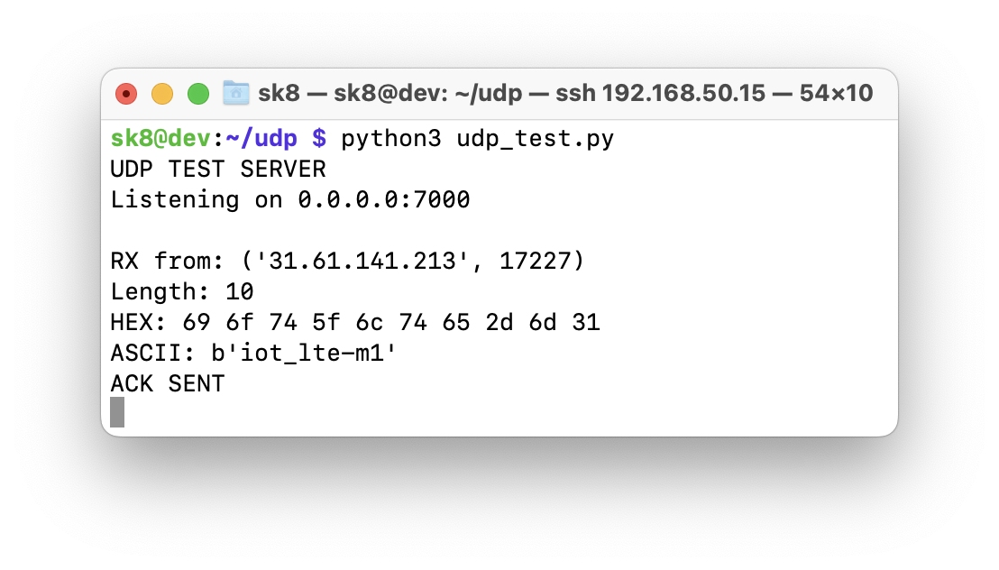
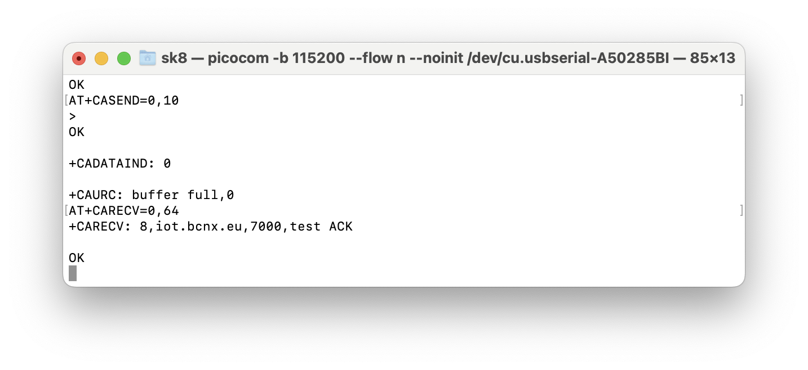
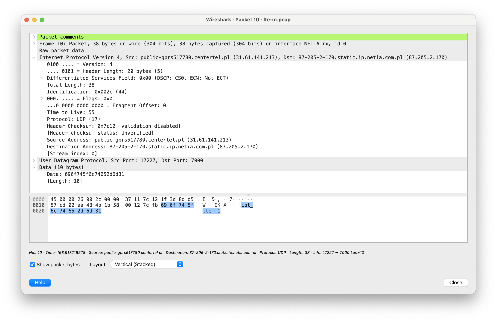
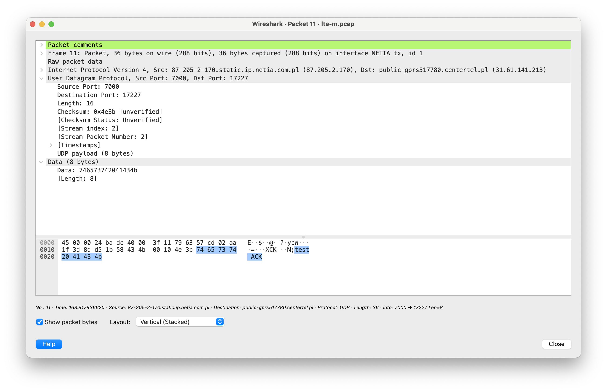

# Moduł SIM7080G
Podstawowe polecenia konfiguracyjne i diagnostyczne modułu SIM7080G.

Opisane poniżej doświadczenie wykonano po podłączeniu modułu do komputera przez konwerter UART, jeszcze przed podłączeniem go do NUCLEO. Celem było zapoznanie się z poleceniami AT i specyfiką działania modułu.

## Polecenia wykonywane podczas inicjalizacji urządzenia

| Polecenie | Oczekiwany wynik | Opis |
| --- | --- | --- |
| `ATE0` | `OK` | wyłączenie echa, co ułatwia parsowanie odpowiedzi |
| `AT` | `OK` | sprawdzenie komunikacji z modułem |
| `AT+CPIN?` | `+CPIN: READY` | sprawdzenie gotowości karty SIM |
| `AT+CMNB=1` | `OK` | wybór trybu pracy: tylko LTE-M (Cat-M) |
| `AT+CGDCONT=1,"IP","iot"` | `OK` | definicja kontekstu PDP (IPv4, APN `iot`) |
| `AT+CNCFG=0,1,"iot"` | `OK` | konfiguracja kontekstu dla aplikacji IP (TCP/UDP, HTTP, MQTT) w profilu 0 |
| `AT+CEREG?` | `+CEREG: 0,1` lub `+CEREG: 0,5` | status rejestracji w sieci: 1 – sieć macierzysta, 5 – roaming |
| `AT+CNACT=0,1` | `+APP PDP: 0,ACTIVE` | aktywacja interfejsu sieciowego dla profilu 0 (weryfikacja: `AT+CNACT?`) |

## Transmisja UDP

### 1. Weryfikacja kontekstu
Przed transmisją należy sprawdzić, czy kontekst jest aktywny.
```
AT+CNACT?
+CNACT: 0,1,"100.97.83.188"
+CNACT: 1,0,"0.0.0.0"
+CNACT: 2,0,"0.0.0.0"
+CNACT: 3,0,"0.0.0.0"

OK
```

Jeżeli kontekst nie jest aktywny, należy go aktywować poleceniem `AT+CNACT=0,1`.

### 2. Otwarcie gniazda UDP
`AT+CAOPEN=<gniazdo>,<kontekst>,"UDP","<adres>",<port>`

- `<gniazdo>` – identyfikator gniazda (tu 0),
- `<kontekst>` – indeks kontekstu PDP (tu 0),
- `"UDP"` – protokół transmisji.

```
AT+CAOPEN=0,0,"UDP","iot.bcnx.eu",7000
+CAOPEN: 0,0

OK
```

### 3. Wysyłanie danych i odbiór ACK
`AT+CASEND=<gniazdo>,<długość_danych>`

Po znaku zachęty `>` należy przesłać dokładnie `<długość_danych>` bajtów.
```
AT+CASEND=0,10
>
OK

+CADATAIND: 0

+CAURC: buffer full,0
```
Odpowiedź `OK` oznacza, że moduł przyjął dane do wysłania. Komunikat `+CADATAIND: 0` informuje, że w gnieździe 0 czekają odebrane dane (ACK z serwera).

Odczyt ACK:
```
AT+CARECV=0,64
+CARECV: 8,iot.bcnx.eu,7000,test ACK

OK
```

Do testu uruchomiono testowy serwer UDP (plik `udp_test.py`), moduł podłączono przez UART i wysłano wiadomość o długości 10 B.






Jeżeli ACK nie zostanie odebrany, należy ponownie wysłać dane poleceniem `AT+CASEND` (retransmisja).

### 4. Zamknięcie gniazda UDP
Zamknięcie gniazda zwalnia zasoby stosu IP: `AT+CACLOSE=0`.
```
AT+CACLOSE=0
OK
```
