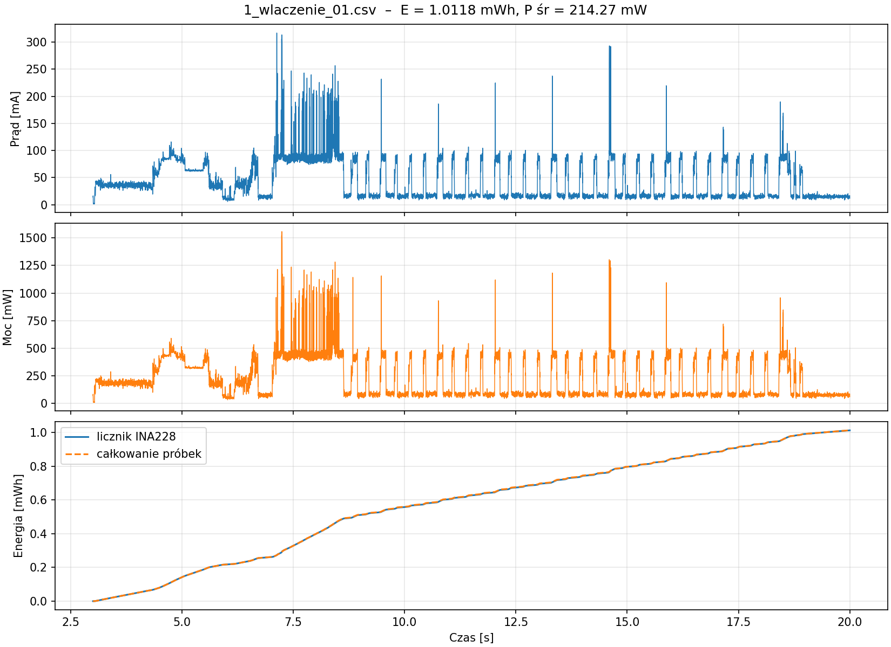
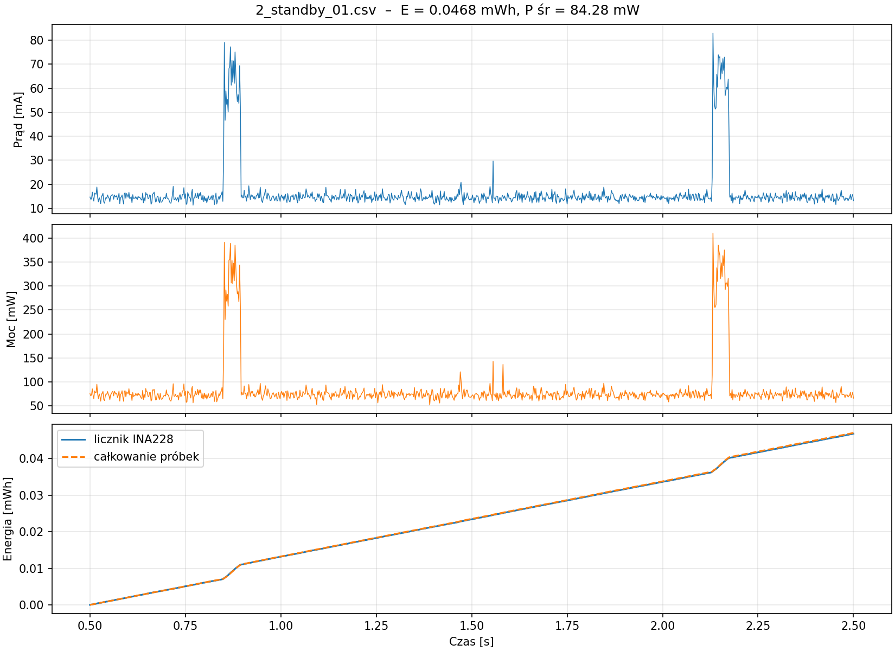
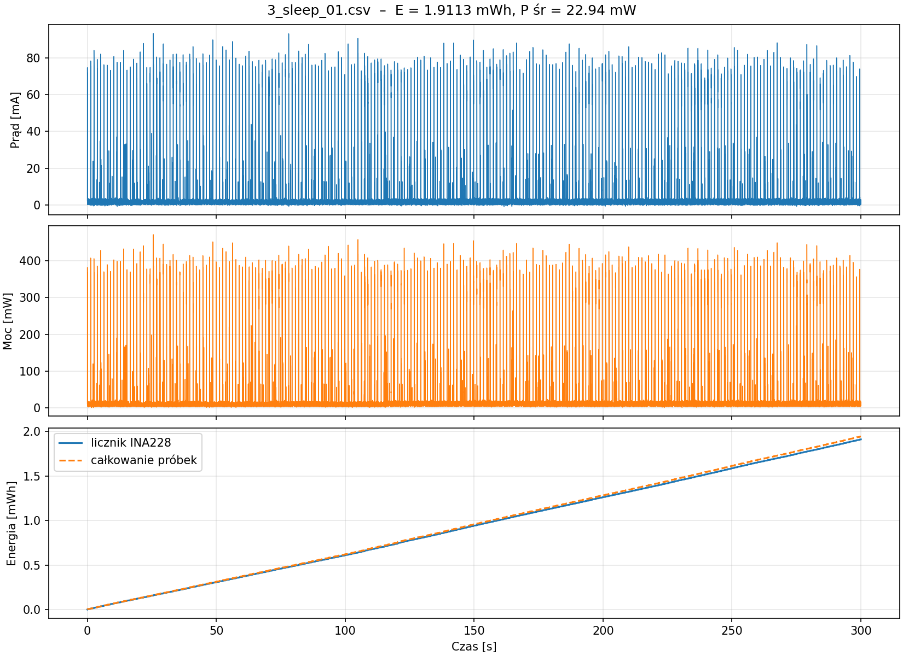
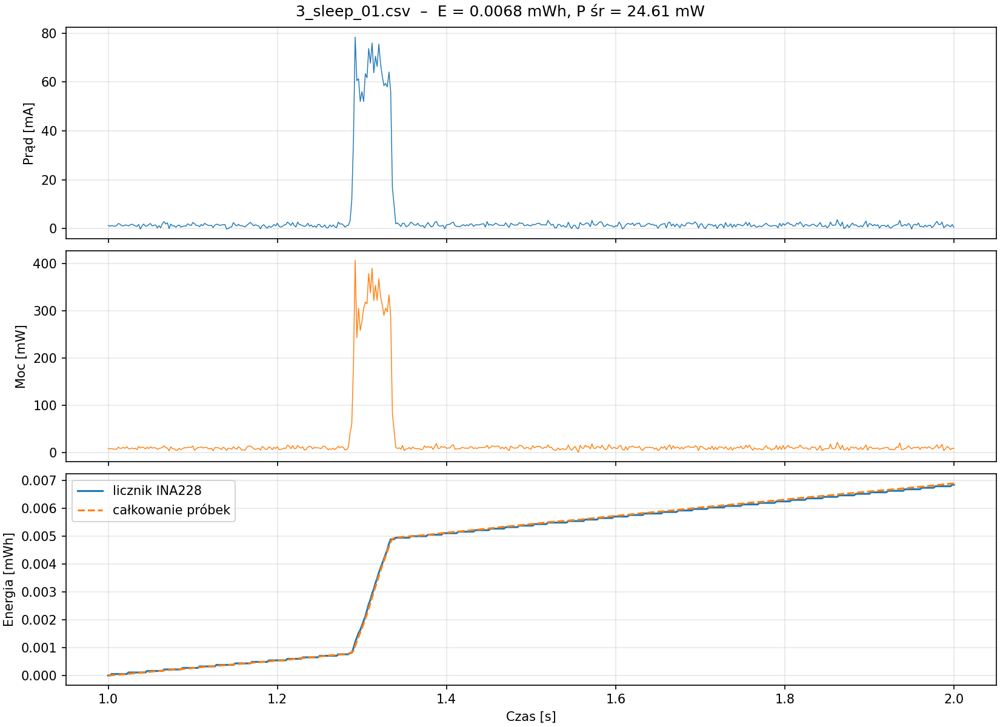
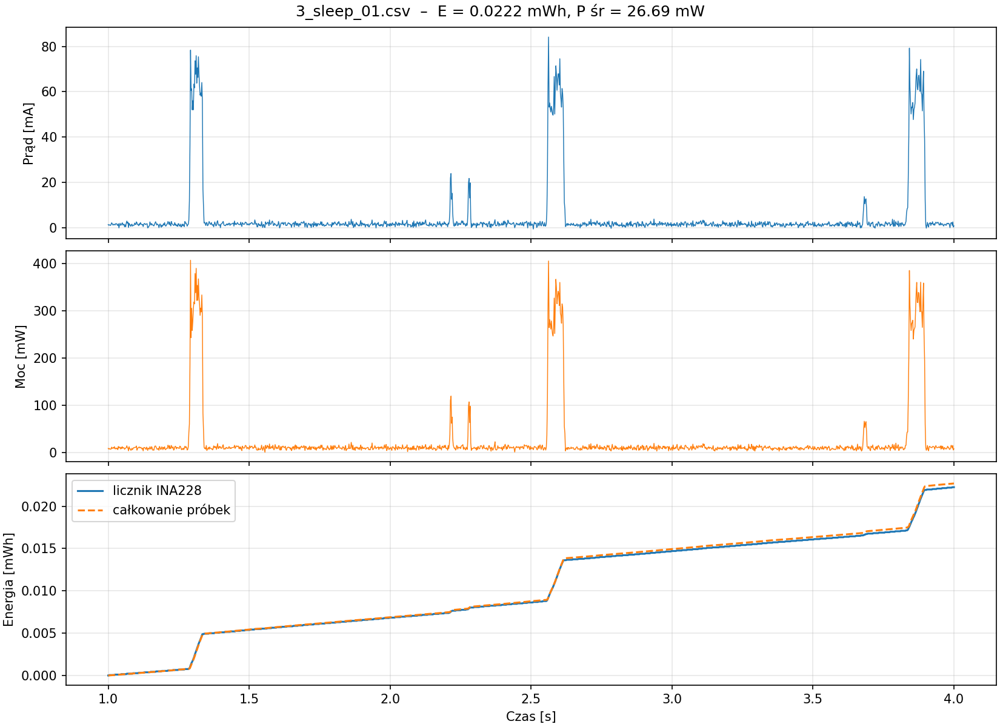
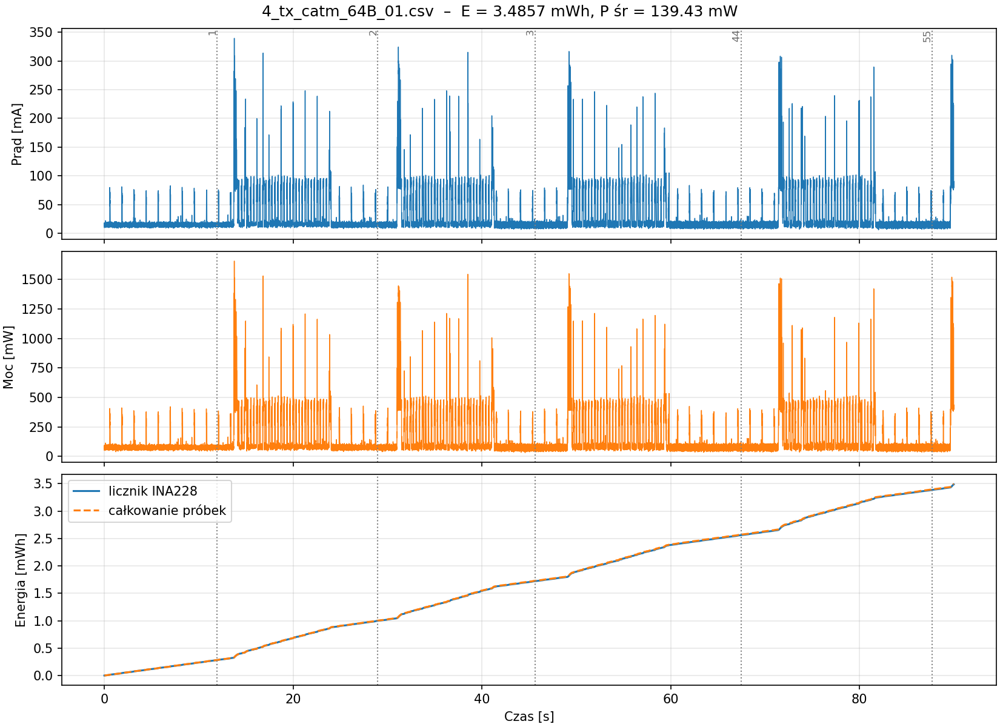
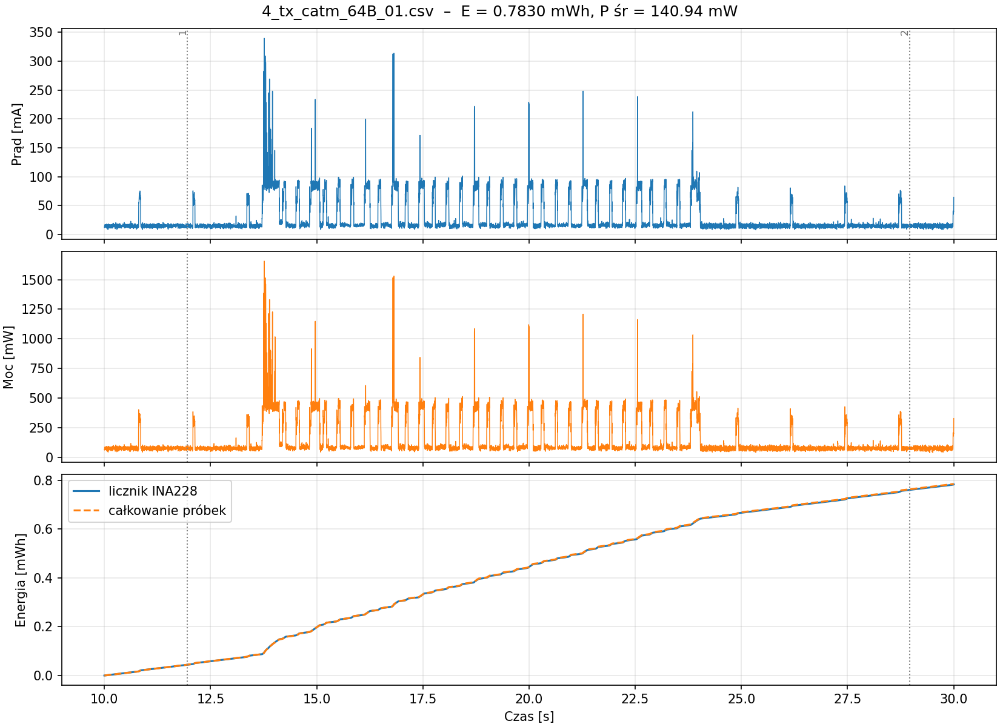
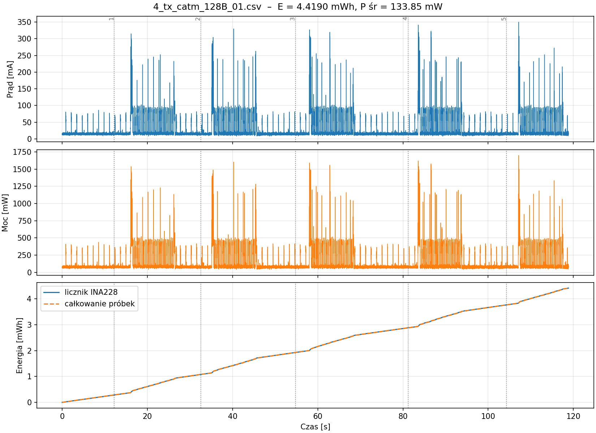
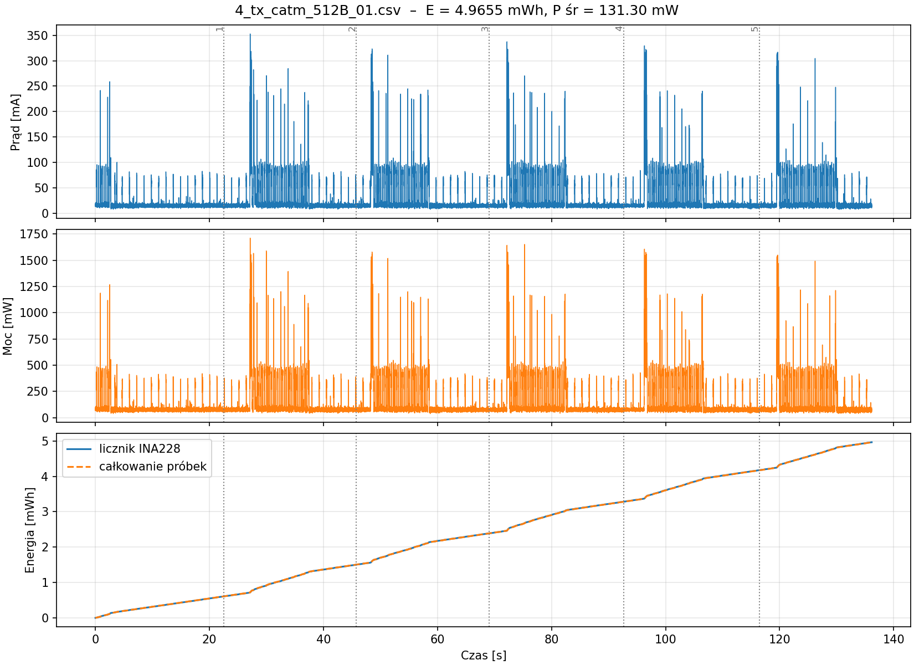
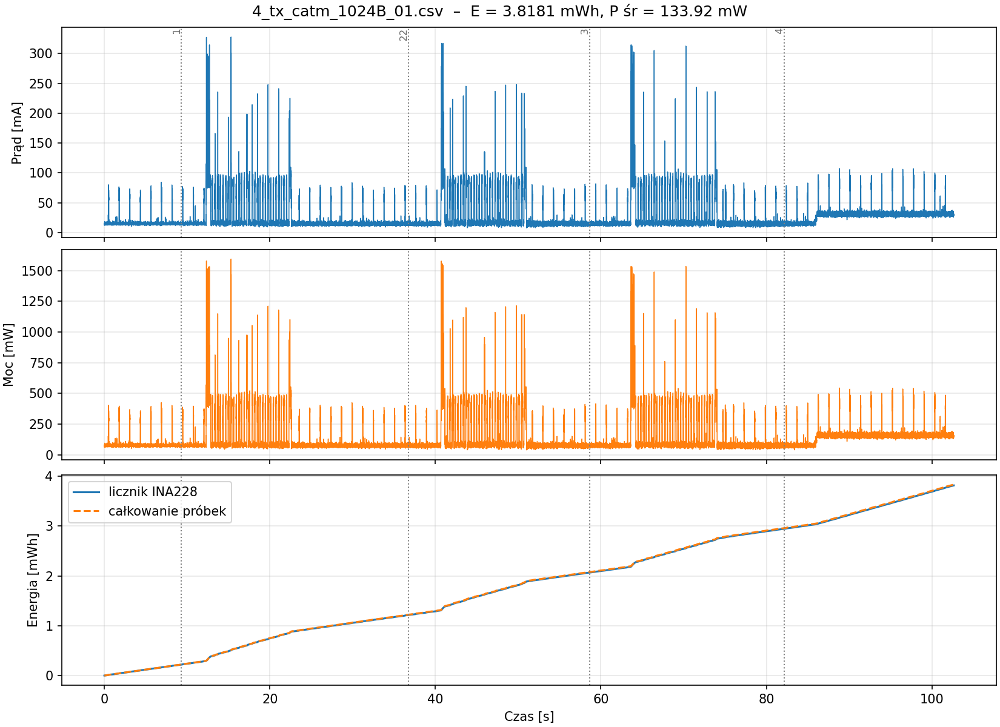

# Pomiary zużycia energii przez moduł SIM7080G

Do pomiarów wykorzystano moduł Adafruit INA228 podłączony do Raspberry Pi 4B. Kod obsługujący INA228 został wygenerowany przy użyciu narzędzia AI Claude - implementacja tego oprogramowania nie jest celem niniejszej pracy.

## Parametry pomiaru

- **Częstotliwość próbkowania:** 500 Hz (`-i 0.002`, odczyt co 2 ms) - pozwala wychwycić krótkie impulsy podczas nadawania i wybudzania modułu.
- **ADC range:** 1 (domyślnie 0) - zwiększa dokładność pomiaru kosztem ograniczenia zakresu do 2,73 A, co w zupełności wystarcza dla badanego układu.
- **Max current:** 2 A - wpływa na rozdzielczość odczytu, jednak nie poprawia znacząco dokładności pomiaru.

> [!NOTE]
> Na tym etapie moduł LTE-M był nadal podłączony do komputera przez konwerter UART. Celem poniższych pomiarów było zapoznanie się z trybami pracy modułu SIM7080G.

## 1. Włączenie modułu

Pomiar obejmuje uruchomienie modułu, a następnie jego pracę w trybie standby. Wykonano trzy próby, w których maksymalny prąd wyniósł odpowiednio 316,83 mA, 330,46 mA i 319,57 mA.

```bash
python3 ina228_logger.py --adc-range 1 --max-current 2 -i 0.002 -d 60 -o 1_wlaczenie_01.csv
```



## 2. Standby - moduł zarejestrowany w sieci, bez transmisji

```bash
python3 ina228_logger.py --adc-range 1 --max-current 2 -i 0.002 -d 120 -o 2_standby_01.csv
```

Wyniki 120-sekundowego pomiaru:

- prąd średni: 16,51 mA,
- prąd min/max: 8,45 / 84,88 mA.



Na wykresie widoczne są dwa wyraźne skoki poboru prądu.

## 3. Tryb sleep

```bash
python3 ina228_logger.py --adc-range 1 --max-current 2 -i 0.002 -d 300 -o 3_sleep_01.csv
```

Po włączeniu modułu odczekano kilka sekund, aż poprawnie zarejestruje się w sieci, a następnie wykonano pomiar.

Według dokumentacji średni pobór prądu w trybie sleep wynosi 1,2 mA, natomiast zmierzona wartość to 4,025 mA. Różnica wynika z tego, że płytka M5Stamp CAT-M oprócz układu SIM7080G zawiera dodatkowe komponenty elektroniczne (m.in. diodę).




Widoczny pik poboru prądu:



## 4. Transmisja

```bash
python3 ina228_logger.py --adc-range 1 --max-current 2 -i 0.002 -d 90 -o 4_tx_catm_100B_01.csv
```

Na potrzeby pomiaru uruchomiono serwer UDP na serwerze VPS.

Przed pomiarem sprawdzono status rejestracji w sieci LTE-M:

```
AT+CPSI?
+CPSI: LTE CAT-M1,Online,260-03,0xCEA5,58441227,201,EUTRAN-BAND20,6200,3,3,-14,-107,-80,8

OK
```

Następnie aktywowano kontekst sieciowy (APP Network Active):

```
AT+CNACT=0,1
OK

+APP PDP: 0,ACTIVE
```

### Przebieg transmisji

Otwarcie połączenia UDP:

```
AT+CAOPEN=0,0,"UDP","frog01.mikr.us",30139
+CAOPEN: 0,0

OK
```

Sprawdzenie maksymalnego rozmiaru pakietu - wynosi on 1460 B:

```
AT+CASEND=?
+CASEND: (0-12),(1-1460),(100-10000)

OK
```

Wysłanie pakietów o zadanej długości:

```
AT+CASEND=0,64
>
OK
```

Poniżej widoczne są 4 transmisje:



Zbliżenie pojedynczej transmisji:



```
AT+CASEND=0,128
>
OK
```



```
AT+CASEND=0,512
>
OK
```



```
AT+CASEND=0,1024
>
OK
```


