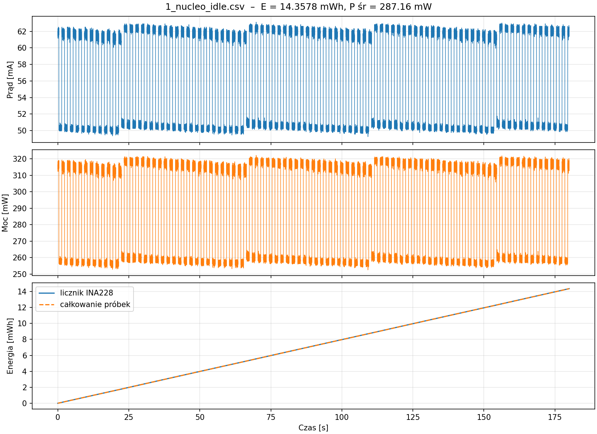
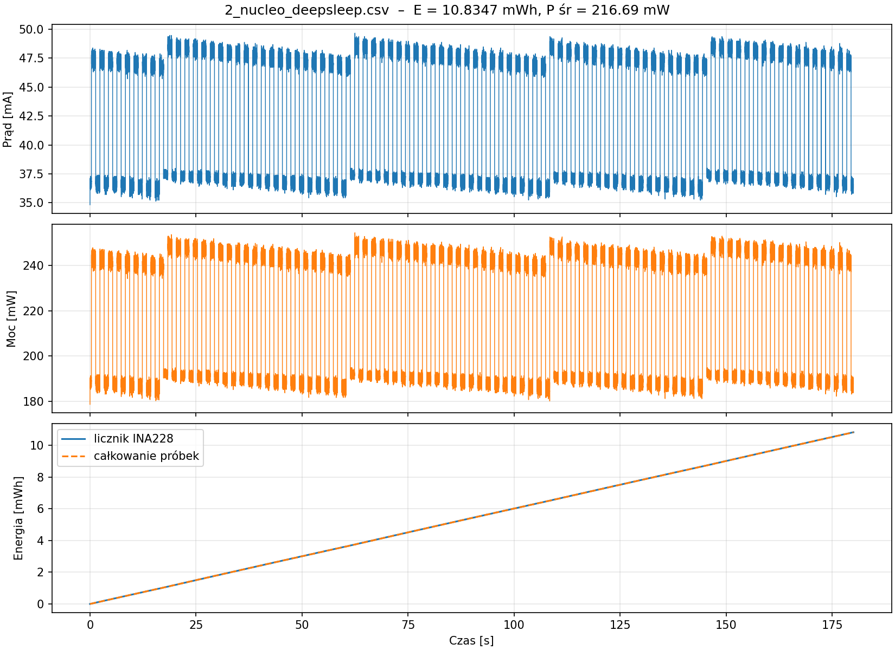
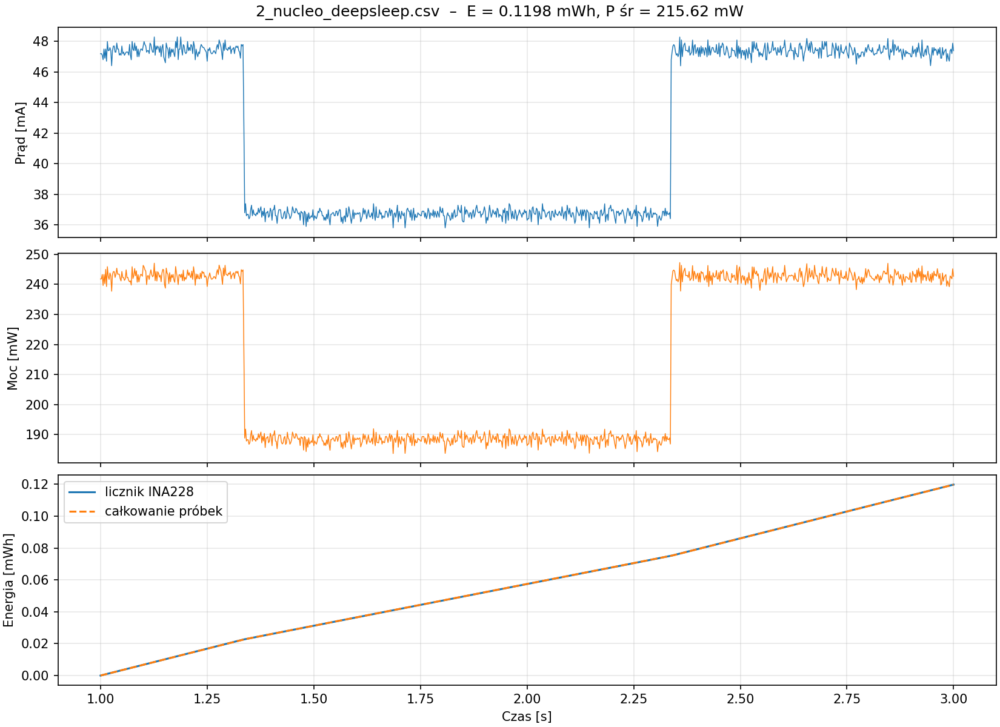
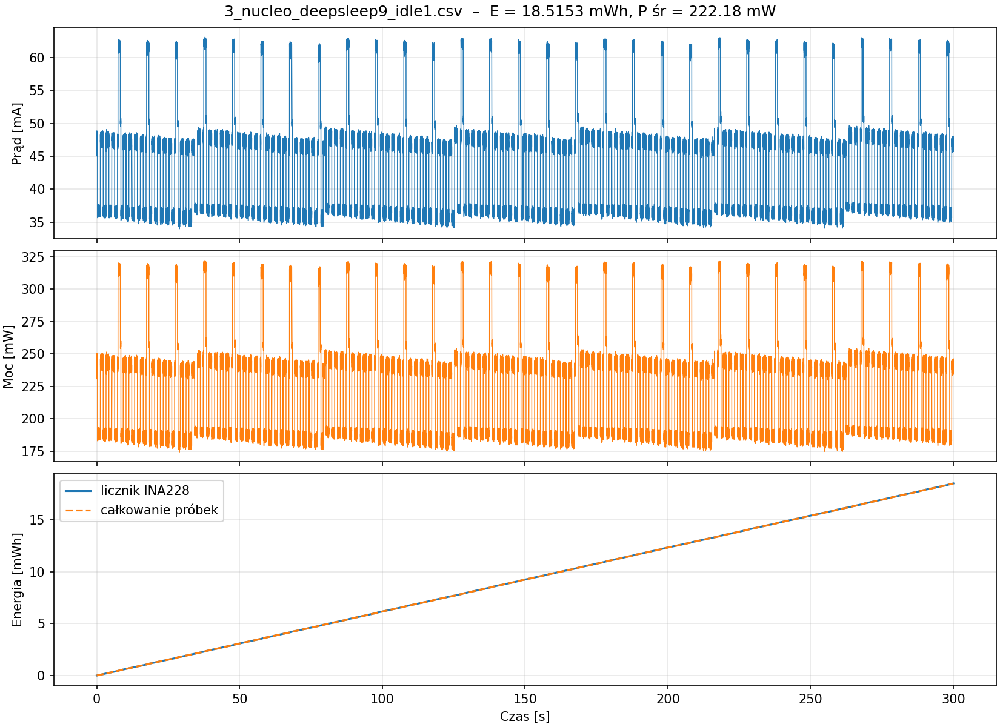

# Pomiary zużycia energii przez płytkę NUCLEO-L476RG

Kolejny eksperyment polegał na zbadaniu zapotrzebowania energetycznego płytki NUCLEO-L476RG.

Płytkę zasilono z zasilacza 5 V. Zworki CN2 (odpowiedzialne za programator ST-LINK) ustawiono w pozycji OFF, a zworkę JP5 w pozycji zasilania z pinu E5V.

Na płytce uruchomiono następujący kod:

```cpp
#include <Arduino.h>
#include <STM32RTC.h>
#include <STM32LowPower.h>

static const uint32_t SLEEP_MS = 5000;

#ifndef BUILD_EPOCH
#define BUILD_EPOCH 1788220800UL  // 2026-09-01 00:00:00 UTC
#endif

STM32RTC& rtc = STM32RTC::getInstance();

void setup() {
    Serial.begin(115200);
    Serial.println("STM32 RTC + Deep Sleep Example");
    delay(10000);

    pinMode(D13, OUTPUT);
    digitalWrite(D13, LOW);

    // Configure the RTC to use the 32.768 kHz external oscillator (LSE).
    // The RTC continues to keep time while the microcontroller is in sleep mode.
    rtc.setClockSource(STM32RTC::LSE_CLOCK);
    rtc.begin();

    // Set the RTC time only on the first startup.
    // The RTC retains its time across resets as long as backup power is available.
    if (!rtc.isTimeSet()) {
        rtc.setEpoch(BUILD_EPOCH);
    }

    LowPower.begin();
}

void loop() {
    uint32_t subSec = 0;
    uint32_t epoch = rtc.getEpoch(&subSec);

    // Example output:
    // [2026-11-19 18:59:03.123] epoch=1795625943 CMD=PING

    char buf[80];

    snprintf(buf, sizeof(buf),
             "[20%02u-%02u-%02u %02u:%02u:%02u.%03lu] epoch=%lu CMD=%s",
             rtc.getYear(), rtc.getMonth(), rtc.getDay(),
             rtc.getHours(), rtc.getMinutes(), rtc.getSeconds(),
             (unsigned long)subSec, (unsigned long)epoch, "TEST");

    Serial.println(buf);
    delay(1000);

    // Wait until all data has been transmitted over UART before entering sleep mode.
    Serial.flush();

    // Enter STOP mode and wake up after SLEEP_MS using the RTC alarm.
    // Program execution continues from this point after waking up (without a reset).
    LowPower.deepSleep(SLEEP_MS);
}
```

## 1. Pobór prądu w trybie IDLE

Wykonano 3-minutowy pomiar z pominięciem wywołań `LowPower.begin()` oraz `LowPower.deepSleep(SLEEP_MS)`.

```bash
ina228_logger.py --adc-range 1 --max-current 0.1 -i 0.002 -d 180 -o 1_nucleo_idle.csv
```

```
sk8@dev:~/energy-monitor/results-NUCLEO $ analyze.py 1_nucleo_idle.csv --save 1_nucleo_idle.png
Plik: 1_nucleo_idle.csv
Przedział: 0.000 – 180.000 s (180.000 s), 90001 próbek, okres ~2.000 ms
Energia (INA228):     51.6880 J = 14.3578 mWh
Energia (całkowanie): 51.6718 J = 14.3533 mWh
Ładunek:              10.1103 C = 2.8084 mAh
Moc średnia: 287.156 mW, maks.: 322.14 mW
Prąd średni: 56.168 mA, maks.: 63.11 mA

Wykres zapisany: 1_nucleo_idle.png
```

Średni pobór prądu: **56,17 mA**.



## 2. Pobór prądu w trybie deep sleep

```bash
ina228_logger.py --adc-range 1 --max-current 0.1 -i 0.002 -d 180 -o 2_nucleo_deepsleep.csv
```

Użyto powyższego kodu, ustawiając `SLEEP_MS` na wartość dłuższą niż czas pomiaru.

```
sk8@dev:~/energy-monitor/results-NUCLEO $ analyze.py 2_nucleo_deepsleep.csv --save 2_nucleo_deepsleep.png
Plik: 2_nucleo_deepsleep.csv
Przedział: 0.000 – 180.000 s (180.000 s), 90001 próbek, okres ~2.000 ms
Energia (INA228):     39.0049 J = 10.8347 mWh
Energia (całkowanie): 38.9938 J = 10.8316 mWh
Ładunek:              7.6089 C = 2.1136 mAh
Moc średnia: 216.694 mW, maks.: 254.38 mW
Prąd średni: 42.272 mA, maks.: 49.66 mA

Wykres zapisany: 2_nucleo_deepsleep.png
```

Średni pobór prądu: **42,27 mA**.



Na zbliżeniu pierwszych 3 sekund pomiaru widać skoki prądu z około 36 mA do około 48 mA, powtarzające się co 1 s. Odpowiada za nie miganie diody `LD1 (Red/Green LED) COM`, która sygnalizuje komunikację ST-LINK. Diody nie da się wyłączyć programowo - zużycie można ograniczyć jedynie przez jej wylutowanie.



## 3. Cykl 9 s deep sleep + 1 s IDLE

Zmierzono pobór prądu samej płytki pracującej naprzemiennie w trybie deep sleep i IDLE.

```bash
ina228_logger.py --adc-range 1 --max-current 0.1 -i 0.002 -d 300 -o 3_nucleo_deepsleep9_idle1.csv
```

```
sk8@dev:~/energy-monitor/results-NUCLEO $ analyze.py 3_nucleo_deepsleep9_idle1.csv --save 3_nucleo_deepsleep9_idle1.png
Plik: 3_nucleo_deepsleep9_idle1.csv
Przedział: 0.000 – 300.000 s (300.000 s), 150001 próbek, okres ~2.000 ms
Energia (INA228):     66.6549 J = 18.5153 mWh
Energia (całkowanie): 66.6358 J = 18.5099 mWh
Ładunek:              13.0076 C = 3.6132 mAh
Moc średnia: 222.183 mW, maks.: 322.21 mW
Prąd średni: 43.359 mA, maks.: 63.12 mA

Wykres zapisany: 3_nucleo_deepsleep9_idle1.png
```

Średni pobór prądu: **43,36 mA**.



## 4. Porównanie: płytka NUCLEO-L476RG a sam mikrokontroler STM32L476

Zworka `JP6 (IDD)` pozwala zmierzyć prąd pobierany wyłącznie przez mikrokontroler STM32L476. Do pomiaru użyto multimetru cyfrowego w trybie amperomierza, wpiętego szeregowo w miejsce zworki JP6.

- **IDLE:** około 14 mA.
- **Deep sleep:** pomiar się nie powiódł - prąd jest zbyt mały dla użytego multimetru (według dokumentacji około 1,18 µA, a z włączonym RTC 1,6 µA).

## Wnioski

NUCLEO-L476RG to płytka deweloperska, a większość mierzonego prądu pobierają jej dodatkowe elementy, a nie sam mikrokontroler. W zastosowaniach komercyjnych projektuje się własne płytki PCB zawierające mikrokontroler i tylko niezbędne komponenty. Pozwala to wyeliminować zużycie energii przez elementy takie jak diody LED, przetwornice napięcia czy programator, w które wyposażona jest płytka deweloperska.
