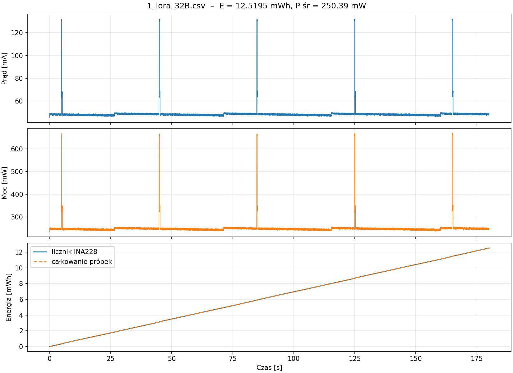
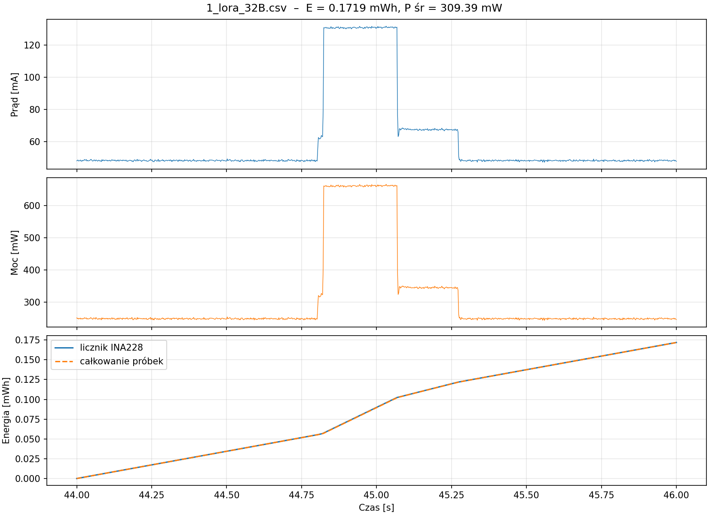
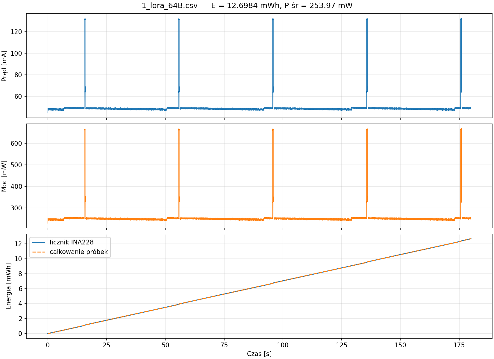
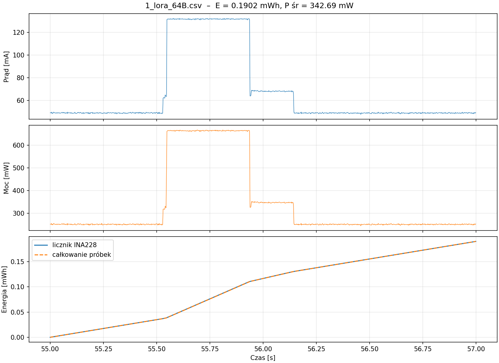
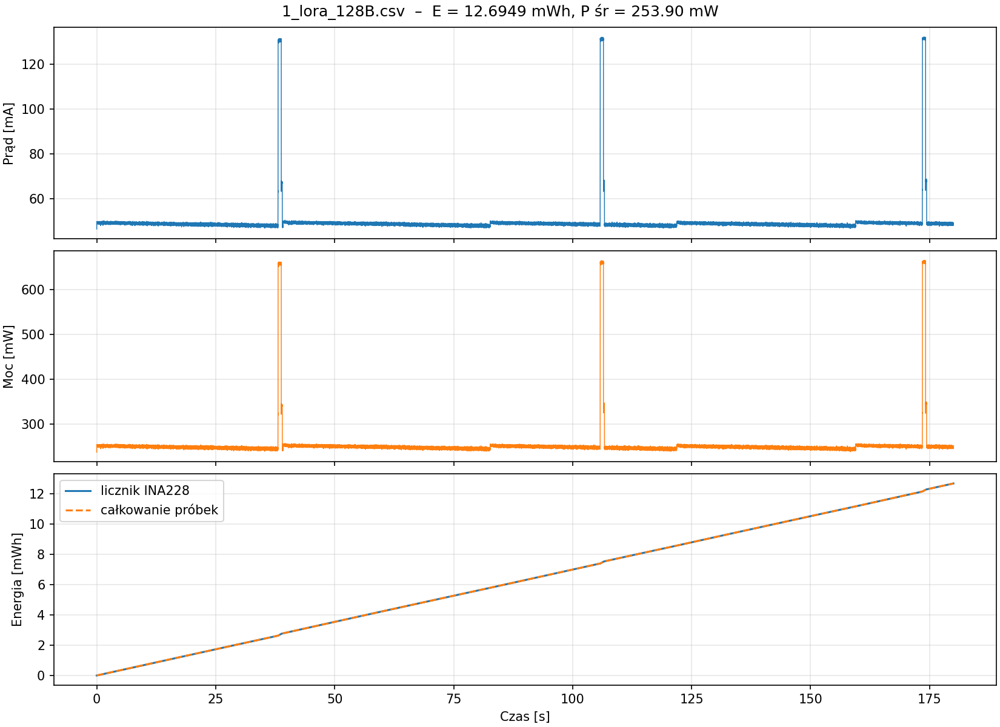
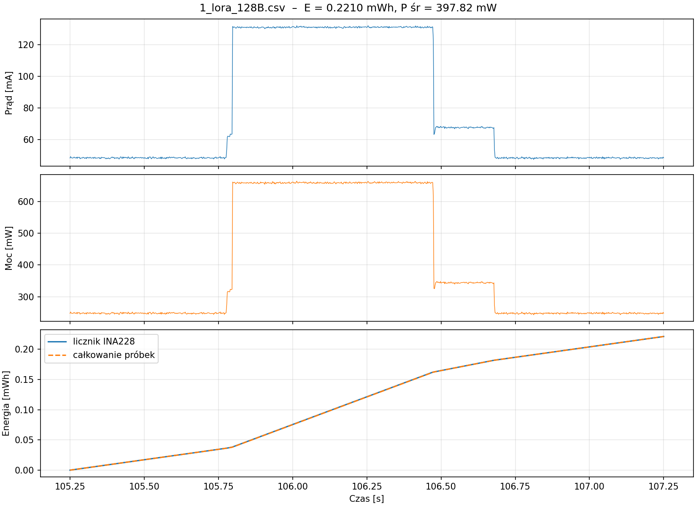
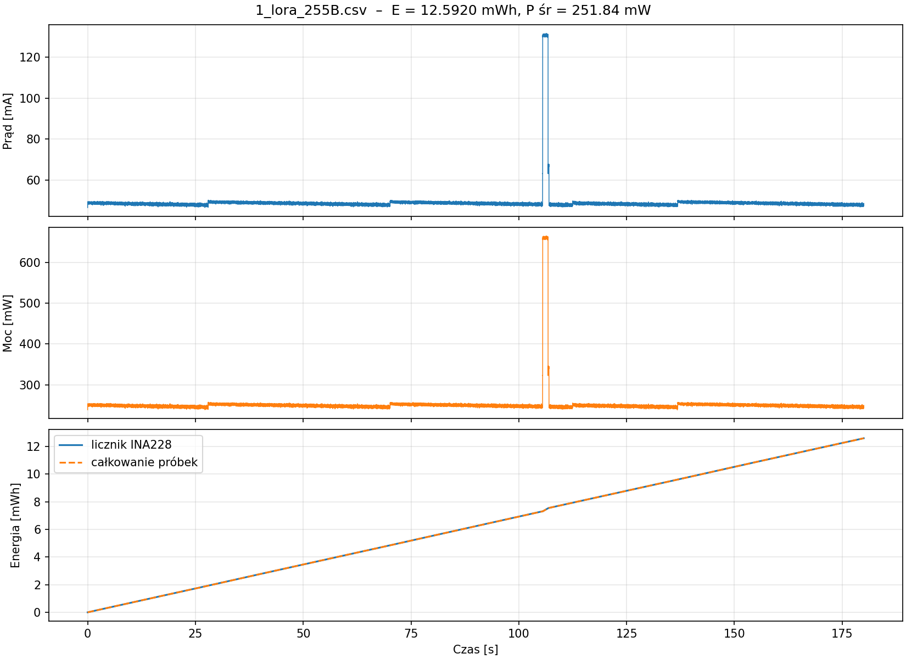
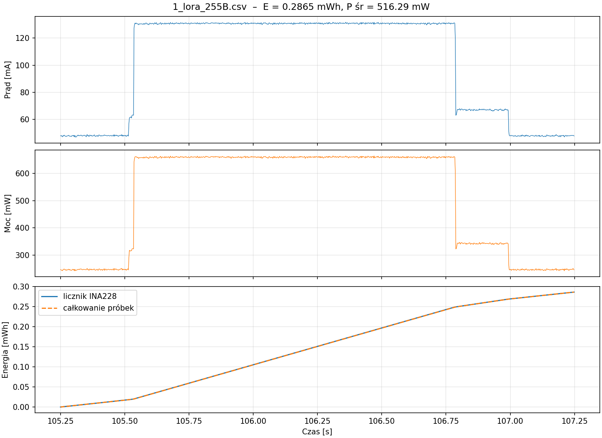

# Pomiary zużycia energii przez moduł LoRa

## Metodyka

Moduł SX1262 podłączono do płytki NUCLEO i uruchomiono cykliczne wysyłanie danych. Peer A wysyła ramkę i oczekuje na ACK - jeśli go nie otrzyma, ponawia transmisję (maksymalnie 3 próby). Następnie NUCLEO przechodzi w tryb deep sleep na czas MAX(40 s, czas wynikający z duty cycle).

Pomiary wykonano przy maksymalnej dopuszczalnej mocy nadawania. Wbudowana dioda, powodująca cosekundowe zmiany poboru prądu, pozostała włączona. Taki sposób pomiaru stosowany jest we wszystkich kolejnych pomiarach.

## Podsumowanie

| Rozmiar ramki | Prąd średni (180 s) | Prąd średni (okno 2 s z transmisją) | Prąd maks. |
|---|---|---|---|
| 32 B | 48,88 mA | 60,63 mA | 132,10 mA |
| 64 B | 49,61 mA | 67,34 mA | 132,47 mA |
| 128 B | 49,62 mA | 78,46 mA | 131,99 mA |
| 255 B | 49,17 mA | 101,98 mA | 131,60 mA |

## Ramka 32 B

```bash
ina228_logger.py --adc-range 1 --max-current 0.3 -i 0.002 -d 180 -o 1_lora_32B.csv
```

```
sk8@dev:~/energy-monitor/results-nucleo-lora $ analyze.py 1_lora_32B.csv --save 1_lora_32B.png
Plik: 1_lora_32B.csv
Przedział: 0.000 – 180.000 s (180.000 s), 90001 próbek, okres ~2.000 ms
Energia (INA228):     45.0703 J = 12.5195 mWh
Energia (całkowanie): 45.0657 J = 12.5183 mWh
Ładunek:              8.7977 C = 2.4438 mAh
Moc średnia: 250.391 mW, maks.: 667.68 mW
Prąd średni: 48.876 mA, maks.: 132.10 mA

Wykres zapisany: 1_lora_32B.png

sk8@dev:~/energy-monitor/results-nucleo-lora $ analyze.py 1_lora_32B.csv --save 1_lora_32B_part.png --from 44 --to 46
Plik: 1_lora_32B.csv
Przedział: 44.000 – 46.000 s (2.000 s), 1001 próbek, okres ~2.000 ms
Energia (INA228):     0.6188 J = 0.1719 mWh
Energia (całkowanie): 0.6186 J = 0.1718 mWh
Ładunek:              0.1213 C = 0.0337 mAh
Moc średnia: 309.389 mW, maks.: 666.18 mW
Prąd średni: 60.634 mA, maks.: 131.70 mA

Wykres zapisany: 1_lora_32B_part.png
```




## Ramka 64 B

```bash
ina228_logger.py --adc-range 1 --max-current 0.3 -i 0.002 -d 180 -o 1_lora_64B.csv
```

```
sk8@dev:~/energy-monitor/results-nucleo-lora $ analyze.py 1_lora_64B.csv --save 1_lora_64B.png
Plik: 1_lora_64B.csv
Przedział: 0.000 – 180.000 s (180.000 s), 90000 próbek, okres ~2.000 ms
Energia (INA228):     45.7141 J = 12.6984 mWh
Energia (całkowanie): 45.7109 J = 12.6975 mWh
Ładunek:              8.9295 C = 2.4804 mAh
Moc średnia: 253.967 mW, maks.: 668.21 mW
Prąd średni: 49.608 mA, maks.: 132.47 mA

sk8@dev:~/energy-monitor/results-nucleo-lora $ analyze.py 1_lora_64B.csv --save 1_lora_64B_part.png --from 55 --to 57
Plik: 1_lora_64B.csv
Przedział: 55.000 – 56.998 s (1.998 s), 1000 próbek, okres ~2.000 ms
Energia (INA228):     0.6847 J = 0.1902 mWh
Energia (całkowanie): 0.6847 J = 0.1902 mWh
Ładunek:              0.1345 C = 0.0374 mAh
Moc średnia: 342.692 mW, maks.: 667.39 mW
Prąd średni: 67.338 mA, maks.: 132.10 mA

Wykres zapisany: 1_lora_64B_part.png
```




## Ramka 128 B

```bash
ina228_logger.py --adc-range 1 --max-current 0.3 -i 0.002 -d 180 -o 1_lora_128B.csv
```

```
sk8@dev:~/energy-monitor/results-nucleo-lora $ analyze.py 1_lora_128B.csv --save 1_lora_128B.png
Plik: 1_lora_128B.csv
Przedział: 0.000 – 180.000 s (180.000 s), 89998 próbek, okres ~2.000 ms
Energia (INA228):     45.7016 J = 12.6949 mWh
Energia (całkowanie): 45.6980 J = 12.6939 mWh
Ładunek:              8.9323 C = 2.4812 mAh
Moc średnia: 253.897 mW, maks.: 665.43 mW
Prąd średni: 49.624 mA, maks.: 131.99 mA

Wykres zapisany: 1_lora_128B.png

sk8@dev:~/energy-monitor/results-nucleo-lora $ analyze.py 1_lora_128B.csv --save 1_lora_128B_part.png --from 105.25 --to 107.25
Plik: 1_lora_128B.csv
Przedział: 105.250 – 107.250 s (2.000 s), 1001 próbek, okres ~2.000 ms
Energia (INA228):     0.7956 J = 0.2210 mWh
Energia (całkowanie): 0.7956 J = 0.2210 mWh
Ładunek:              0.1569 C = 0.0436 mAh
Moc średnia: 397.823 mW, maks.: 664.94 mW
Prąd średni: 78.464 mA, maks.: 131.89 mA

Wykres zapisany: 1_lora_128B_part.png
```




## Ramka 255 B

```bash
ina228_logger.py --adc-range 1 --max-current 0.3 -i 0.002 -d 180 -o 1_lora_255B.csv
```

```
sk8@dev:~/energy-monitor/results-nucleo-lora $ analyze.py 1_lora_255B.csv --save 1_lora_255B.png
Plik: 1_lora_255B.csv
Przedział: 0.000 – 180.000 s (180.000 s), 90000 próbek, okres ~2.000 ms
Energia (INA228):     45.3313 J = 12.5920 mWh
Energia (całkowanie): 45.3286 J = 12.5913 mWh
Ładunek:              8.8513 C = 2.4587 mAh
Moc średnia: 251.840 mW, maks.: 664.92 mW
Prąd średni: 49.174 mA, maks.: 131.60 mA

Wykres zapisany: 1_lora_255B.png

sk8@dev:~/energy-monitor/results-nucleo-lora $ analyze.py 1_lora_255B.csv --save 1_lora_255B_part.png --from 105.25 --to 107.25
Plik: 1_lora_255B.csv
Przedział: 105.250 – 107.248 s (1.998 s), 1000 próbek, okres ~2.000 ms
Energia (INA228):     1.0315 J = 0.2865 mWh
Energia (całkowanie): 1.0314 J = 0.2865 mWh
Ładunek:              0.2038 C = 0.0566 mAh
Moc średnia: 516.288 mW, maks.: 664.92 mW
Prąd średni: 101.981 mA, maks.: 131.60 mA

Wykres zapisany: 1_lora_255B_part.png
```



