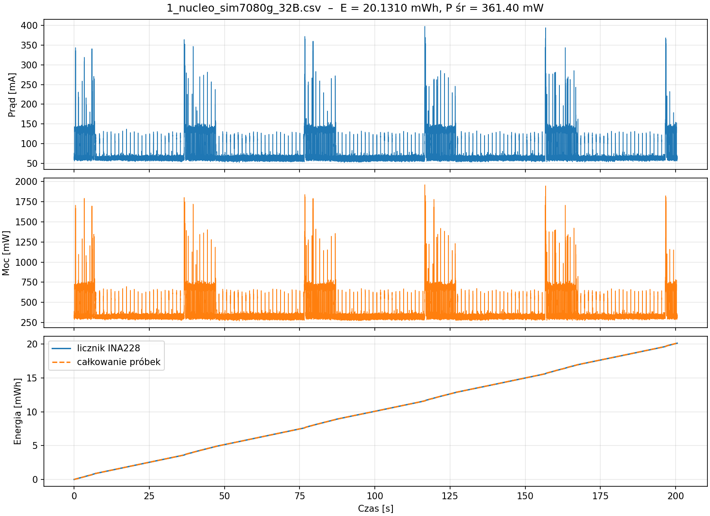
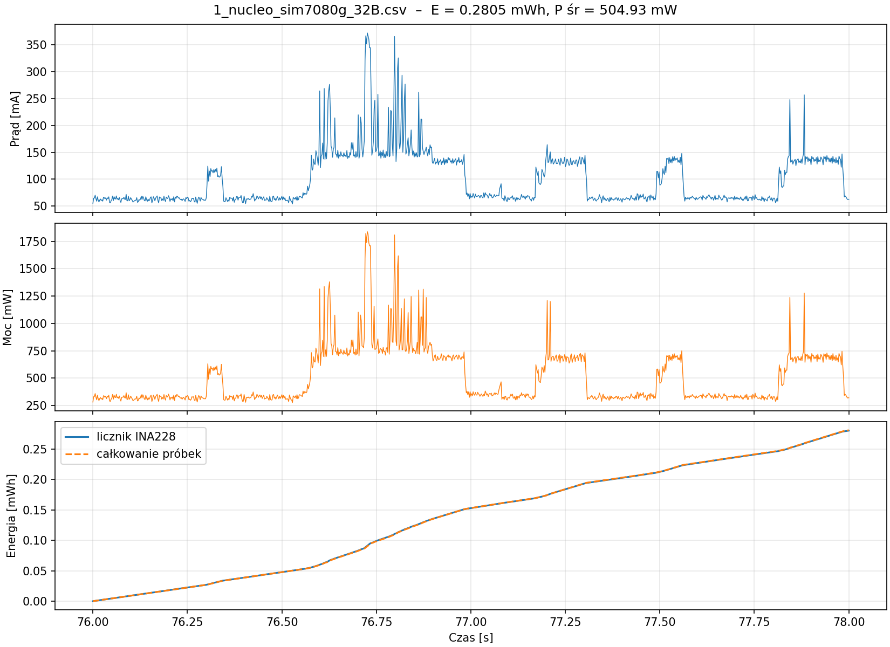
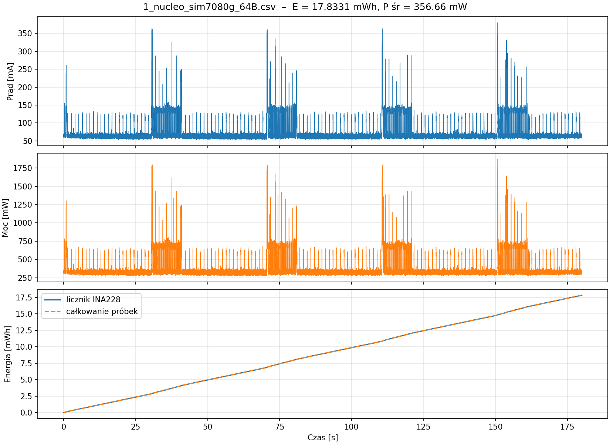
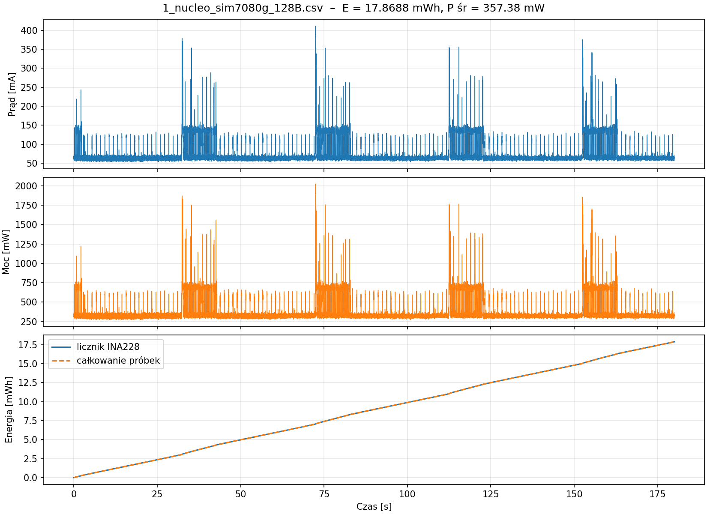
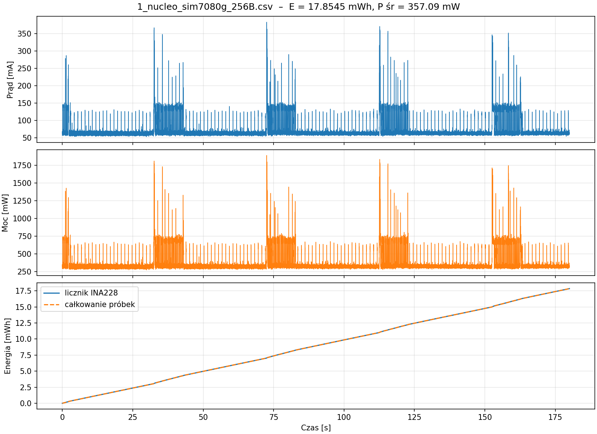
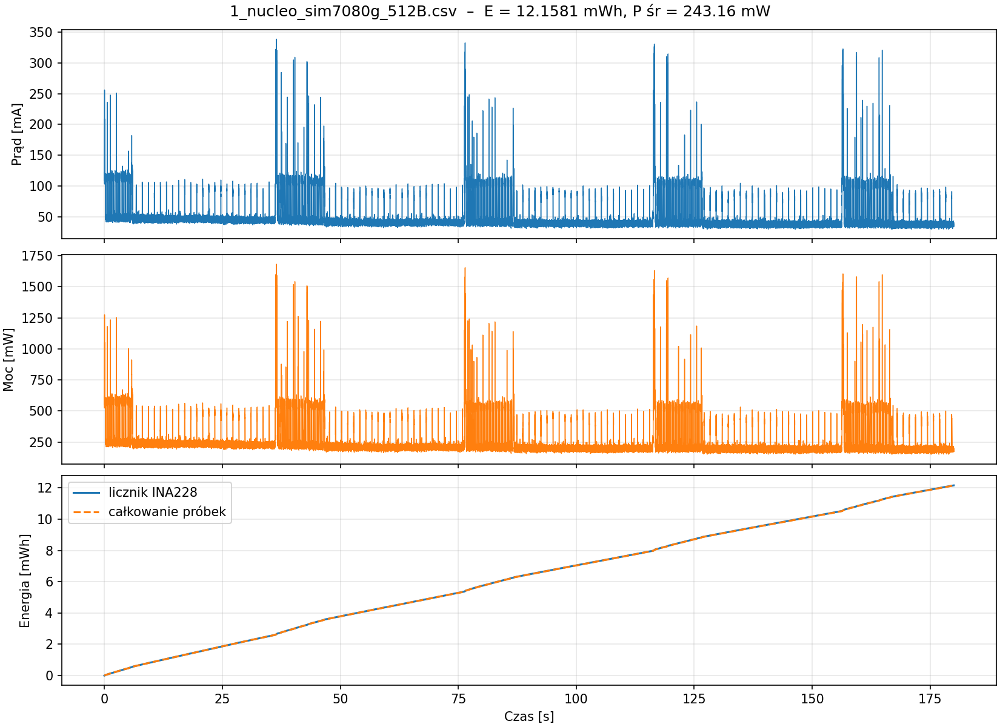
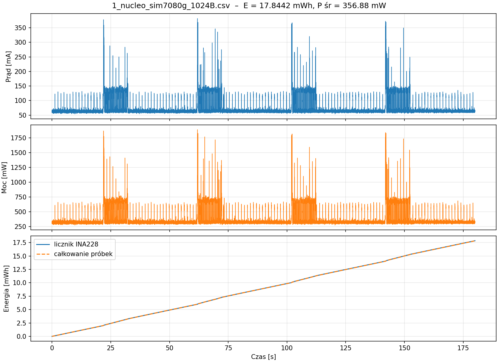

# Pomiary zużycia energii - NUCLEO + LTE-M

## Metodyka

Pomiar przeprowadzono analogicznie do [pomiaru LoRa](08-lora-energu.md), z tą różnicą, że transmisja odbywa się co 40 s.

Na podstawie wcześniejszych pomiarów samej płytki NUCLEO oraz modułu SIM7080G maksymalny prąd chwilowy oszacowano na 0,5 A (`--max-current 0.5`).

## Podsumowanie

| Rozmiar ramki | Czas pomiaru | Prąd średni | Prąd maks. | Moc średnia |
|---|---|---|---|---|
| 32 B | 200,5 s | 70,79 mA | 397,57 mA | 361,40 mW |
| 64 B | 180 s | 69,86 mA | 380,02 mA | 356,66 mW |
| 128 B | 180 s | 70,02 mA | 410,92 mA | 357,38 mW |
| 256 B | 180 s | 69,95 mA | 383,07 mA | 357,09 mW |
| 512 B | 180 s | 47,50 mA | 338,91 mA | 243,16 mW |
| 1024 B | 180 s | 69,88 mA | 381,88 mA | 356,88 mW |

Średni pobór prądu praktycznie nie zależy od rozmiaru ramki (ok. 70 mA). Wyjątkiem jest pomiar 512 B, którego wynik (47,50 mA) znacząco odbiega od pozostałych.

## Ramka 32 B

```bash
ina228_logger.py --adc-range 1 --max-current 0.5 -i 0.002 -d 300 -o 1_nucleo_sim7080g_32B.csv
```

```
sk8@dev:~/energy-monitor/results-nucleo-sim7080g $ analyze.py 1_nucleo_sim7080g_32B.csv --save 1_nucleo_sim7080g_32B.png
Plik: 1_nucleo_sim7080g_32B.csv
Przedział: 0.000 – 200.528 s (200.528 s), 100265 próbek, okres ~2.000 ms
Energia (INA228):     72.4715 J = 20.1310 mWh
Energia (całkowanie): 72.5087 J = 20.1413 mWh
Ładunek:              14.1957 C = 3.9432 mAh
Moc średnia: 361.404 mW, maks.: 1959.70 mW
Prąd średni: 70.791 mA, maks.: 397.57 mA

Wykres zapisany: 1_nucleo_sim7080g_32B.png

sk8@dev:~/energy-monitor/results-nucleo-sim7080g $ analyze.py 1_nucleo_sim7080g_32B.csv --save 1_nucleo_sim7080g_32B_part.png --from 76 --to 78
Plik: 1_nucleo_sim7080g_32B.csv
Przedział: 76.000 – 78.000 s (2.000 s), 1001 próbek, okres ~2.000 ms
Energia (INA228):     1.0099 J = 0.2805 mWh
Energia (całkowanie): 1.0121 J = 0.2811 mWh
Ładunek:              0.1989 C = 0.0553 mAh
Moc średnia: 504.932 mW, maks.: 1838.50 mW
Prąd średni: 99.455 mA, maks.: 371.97 mA

Wykres zapisany: 1_nucleo_sim7080g_32B_part.png
```




## Ramka 64 B

```bash
ina228_logger.py --adc-range 1 --max-current 0.5 -i 0.002 -d 180 -o 1_nucleo_sim7080g_64B.csv
```

```
sk8@dev:~/energy-monitor/results-nucleo-sim7080g $ analyze.py 1_nucleo_sim7080g_64B.csv --save 1_nucleo_sim7080g_64B.png
Plik: 1_nucleo_sim7080g_64B.csv
Przedział: 0.000 – 180.000 s (180.000 s), 90001 próbek, okres ~2.000 ms
Energia (INA228):     64.1991 J = 17.8331 mWh
Energia (całkowanie): 64.1980 J = 17.8328 mWh
Ładunek:              12.5740 C = 3.4928 mAh
Moc średnia: 356.662 mW, maks.: 1875.18 mW
Prąd średni: 69.856 mA, maks.: 380.02 mA

Wykres zapisany: 1_nucleo_sim7080g_64B.png
```



## Ramka 128 B

```bash
ina228_logger.py --adc-range 1 --max-current 0.5 -i 0.002 -d 180 -o 1_nucleo_sim7080g_128B.csv
```

```
sk8@dev:~/energy-monitor/results-nucleo-sim7080g $ analyze.py 1_nucleo_sim7080g_128B.csv --save 1_nucleo_sim7080g_128B.png
Plik: 1_nucleo_sim7080g_128B.csv
Przedział: 0.000 – 180.000 s (180.000 s), 90001 próbek, okres ~2.000 ms
Energia (INA228):     64.3277 J = 17.8688 mWh
Energia (całkowanie): 64.3088 J = 17.8636 mWh
Ładunek:              12.6029 C = 3.5008 mAh
Moc średnia: 357.376 mW, maks.: 2023.35 mW
Prąd średni: 70.016 mA, maks.: 410.92 mA

Wykres zapisany: 1_nucleo_sim7080g_128B.png
```



## Ramka 256 B

```bash
ina228_logger.py --adc-range 1 --max-current 0.5 -i 0.002 -d 180 -o 1_nucleo_sim7080g_256B.csv
```

```
sk8@dev:~/energy-monitor/results-nucleo-sim7080g $ analyze.py 1_nucleo_sim7080g_256B.csv --save 1_nucleo_sim7080g_256B.png
Plik: 1_nucleo_sim7080g_256B.csv
Przedział: 0.000 – 180.000 s (180.000 s), 90001 próbek, okres ~2.000 ms
Energia (INA228):     64.2761 J = 17.8545 mWh
Energia (całkowanie): 64.2767 J = 17.8546 mWh
Ładunek:              12.5903 C = 3.4973 mAh
Moc średnia: 357.089 mW, maks.: 1890.07 mW
Prąd średni: 69.946 mA, maks.: 383.07 mA

Wykres zapisany: 1_nucleo_sim7080g_256B.png
```



## Ramka 512 B

```bash
ina228_logger.py --adc-range 1 --max-current 0.5 -i 0.002 -d 180 -o 1_nucleo_sim7080g_512B.csv
```

```
sk8@dev:~/energy-monitor/results-nucleo-sim7080g $ analyze.py 1_nucleo_sim7080g_512B.csv --save 1_nucleo_sim7080g_512B.png
Plik: 1_nucleo_sim7080g_512B.csv
Przedział: 0.000 – 180.000 s (180.000 s), 90001 próbek, okres ~2.000 ms
Energia (INA228):     43.7693 J = 12.1581 mWh
Energia (całkowanie): 43.7322 J = 12.1478 mWh
Ładunek:              8.5498 C = 2.3750 mAh
Moc średnia: 243.163 mW, maks.: 1681.29 mW
Prąd średni: 47.499 mA, maks.: 338.91 mA

Wykres zapisany: 1_nucleo_sim7080g_512B.png
```



## Ramka 1024 B

```bash
ina228_logger.py --adc-range 1 --max-current 0.5 -i 0.002 -d 180 -o 1_nucleo_sim7080g_1024B.csv
```

```
sk8@dev:~/energy-monitor/results-nucleo-sim7080g $ analyze.py 1_nucleo_sim7080g_1024B.csv --save 1_nucleo_sim7080g_1024B.png
Plik: 1_nucleo_sim7080g_1024B.csv
Przedział: 0.000 – 180.000 s (180.000 s), 90001 próbek, okres ~2.000 ms
Energia (INA228):     64.2390 J = 17.8442 mWh
Energia (całkowanie): 64.1811 J = 17.8281 mWh
Ładunek:              12.5778 C = 3.4938 mAh
Moc średnia: 356.883 mW, maks.: 1891.18 mW
Prąd średni: 69.876 mA, maks.: 381.88 mA

Wykres zapisany: 1_nucleo_sim7080g_1024B.png
```


